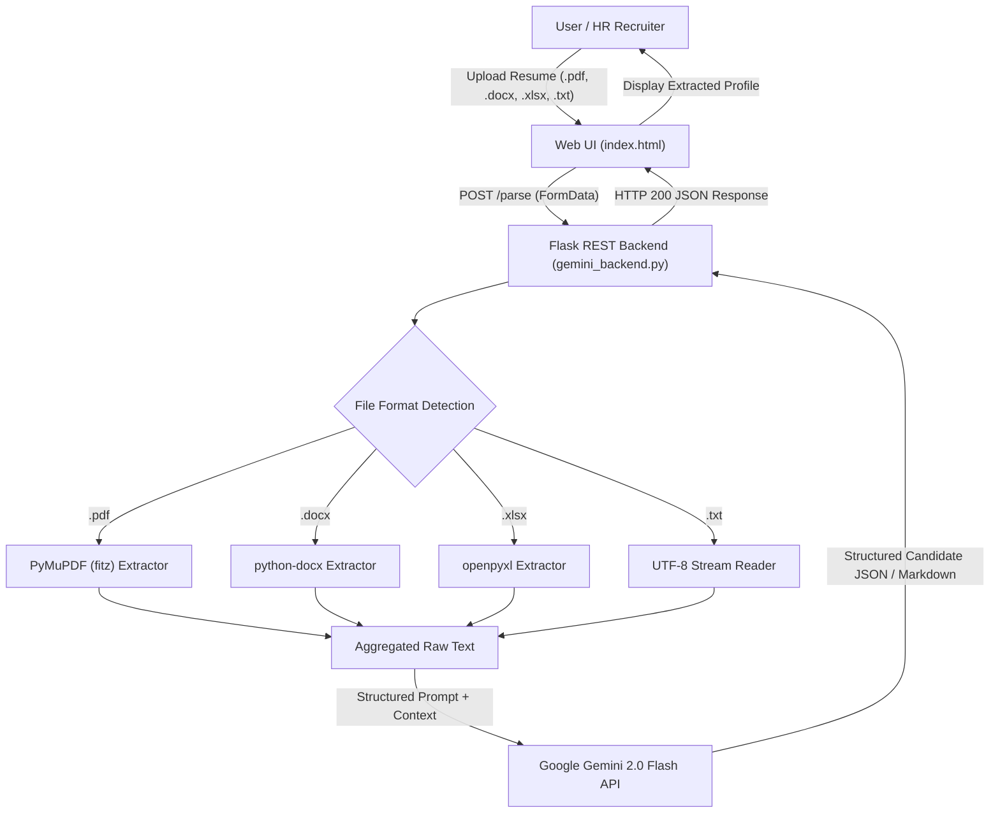

# 📄 AI Resume Parser | Powered by Google Gemini 2.0 Flash

[](https://www.python.org/)
[](https://flask.palletsprojects.com/)
[](https://ai.google.dev/)
[](https://pymupdf.readthedocs.io/)
[](LICENSE)

An intelligent, multi-format **Resume Parsing and Entity Extraction System** that transforms unstructured resume files into structured, actionable candidate data using **Google Gemini 2.0 Flash LLM** and a **Flask REST API**.

---

## 🌟 Key Features

- **📑 Universal Multi-Format Ingestion:** 
  - **PDF Documents (`.pdf`)**: High-fidelity text extraction using `PyMuPDF` (`fitz`).
  - **Word Documents (`.docx`)**: Paragraph and section parsing via `python-docx`.
  - **Excel Spreadsheets (`.xlsx`)**: Multi-sheet tabular parsing with `openpyxl`.
  - **Plain Text (`.txt`)**: Fast direct text decoding.
  - **Tabular Datasets (`.csv`)**: Batch conversion pipeline into individual candidate text files.
- **🧠 Zero-Shot LLM Information Extraction:** Leverages `gemini-2.0-flash` to extract and structure:
  - 👤 **Full Name**
  - 📧 **Email Address**
  - 📱 **Phone Number**
  - 🛠️ **Technical & Domain Skills**
  - 💼 **Professional Experience & Work History**
  - 🎓 **Education & Academic Background**
- **🎨 Interactive Web Dashboard:** A sleek, responsive dark-mode cyber UI with real-time upload progress, animated status indicators, and clean structured output.
- **⚡ RESTful Microservice Architecture:** Decoupled Flask backend with `Flask-CORS` for seamless frontend/backend separation or integration into existing HRMS/ATS pipelines.
- **☁️ Cloud Deployment Ready:** Includes `Procfile` configured for one-click deployment on platforms like Render, Railway, or Heroku.

---

## 🏗️ System Architecture



---

## 📂 Project Structure

```text
├── api_storing.env         # Environment configuration (Gemini API Key)
├── gemini_backend.py       # Core Flask REST API & Gemini parsing logic
├── convert_csv_to_txt.py   # Utility script to convert bulk CSV resumes into TXT files
├── index.html              # Frontend user interface
├── script.js               # Frontend AJAX / Fetch logic for file uploading
├── style.css               # Modern dark-mode styling
├── requirements.txt        # Full Python dependencies list
├── procfile                # Deployment configuration for PaaS (Heroku / Render)
├── resume_testing.txt      # Sample text resume for quick testing
└── converted_resumes_/     # Sample test resumes in PDF, DOCX, and TXT formats
    ├── SWE_Resume_Template.pdf
    ├── Resume_Template1.docx
    ├── Resume_Template2.docx
    └── resume_testing.txt
```

---

## 🚀 Getting Started

### 1. Clone the Repository

```bash
git clone https://github.com/Md-SAMI-7/--Resume_Parser-.git
cd --Resume_Parser-
```

### 2. Create and Activate Virtual Environment

```bash
# Windows
python -m venv venv
venv\Scripts\activate

# macOS / Linux
python3 -m venv venv
source venv/bin/activate
```

### 3. Install Dependencies

```bash
pip install -r requirements.txt
```

### 4. Configure Gemini API Key

Get an API key from [Google AI Studio](https://aistudio.google.com/).

Create a `.env` file (or update `api_storing.env`) in the root directory:

```env
GEMINI_API_KEY=your_google_gemini_api_key_here
```

---

## 💻 Running the Application

### 1. Start the Flask Backend Server

```bash
python gemini_backend.py
```
The server will boot up at: `http://127.0.0.1:5000`

### 2. Launch the Web Interface

Simply open `index.html` in your web browser (double-click the file, or serve it using an HTTP server):

```bash
# Optional: run a local static file server
python -m http.server 8000
```
Then navigate to `http://localhost:8000` in your browser.

### 3. Batch Convert Resumes from CSV (Optional)

If you have a CSV dataset of resumes (e.g., `Fake.csv`), batch convert them into individual text files:

```bash
python convert_csv_to_txt.py
```
Output files will be generated under `converted_resumes/`.

---

## 📡 API Reference

### `POST /parse`

Uploads and parses a single candidate resume.

- **URL:** `http://127.0.0.1:5000/parse`
- **Method:** `POST`
- **Content-Type:** `multipart/form-data`
- **Body:**
  - `file`: *(binary)* The resume file (`.pdf`, `.docx`, `.xlsx`, `.txt`).

#### Sample cURL Request:

```bash
curl -X POST http://127.0.0.1:5000/parse \
  -F "file=@resume_testing.txt"
```

#### Sample Response:

```json
{
  "result": "- Name: John Doe\n- Email: johndoe@example.com\n- Phone: (123) 456-7890\n- Skills: Python, Java, C++, HTML, CSS, JavaScript, Flask, Git, VS Code, Postman\n- Experience: Software Development Intern at ABC Tech Solutions (Jan 2022 - June 2022)\n- Education: Bachelor of Technology in Computer Science, XYZ University (2022)"
}
```

---

## 🧪 Testing with Included Samples

The repository includes ready-to-test candidate resumes in multiple formats inside `converted_resumes_/` and `resume_testing.txt`:
- **`SWE_Resume_Template.pdf`**: Multi-page Software Engineer PDF resume.
- **`Resume_Template1.docx`**: Formatted Microsoft Word DOCX resume.
- **`resume_testing.txt`**: Standard ASCII text resume.

---

## 👤 Author

**Syed Mohammad Samiul Ahmed**  
- GitHub: [@Md-SAMI-7](https://github.com/Md-SAMI-7)

---

## 📜 License

This project is licensed under the [MIT License](LICENSE) - feel free to use and adapt it for personal and commercial projects.
